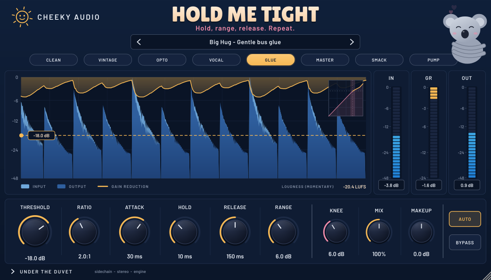

# Cheeky Audio

**Rude names. Serious plugins.** Mac audio plugins (AU + VST3) made in Amsterdam. Free while they're in beta.

**Website and downloads:** https://cheekyplugins.github.io/cheekyplugins/

| Plugin | What it is |
|---|---|
| **Spread 'Em!** | Stereo imager. The face gets more scandalised the wider you go. |
| **Squeeze Me!** | A proper compressor for people who don't know what release does. |
| **Little Synths** | Late-80s polysynth. Tell me sweet little synths. |
| **Slap & Tickle** | Transient shaper with an AI-stem rescue. Sort your hits out. |
| **Hold Me Tight** | Pro compressor with a scrolling display. Hold, range, release. Repeat. |
| **Gimme Some Booty** | Disco and funk bass synth. Coming soon. |

## Download
Grab the DMGs from [Releases](https://github.com/cheekyplugins/cheekyplugins/releases/latest).
They aren't signed with a paid Apple certificate yet, so the first time you install, open
System Settings › Privacy & Security and click **Open Anyway**. The Read Me in each DMG walks you through it.

Apple Silicon and Intel, macOS 11 or newer. Works in Logic, Ableton, Reaper, Cubase, Studio One, FL Studio, Bitwig and GarageBand.

## Bugs and ideas
Open an [issue](https://github.com/cheekyplugins/cheekyplugins/issues) with your DAW, your macOS version and what you were doing.

Fonts: Lilita One and Barlow, SIL Open Font License. © Cheeky Audio. All rights reserved.
